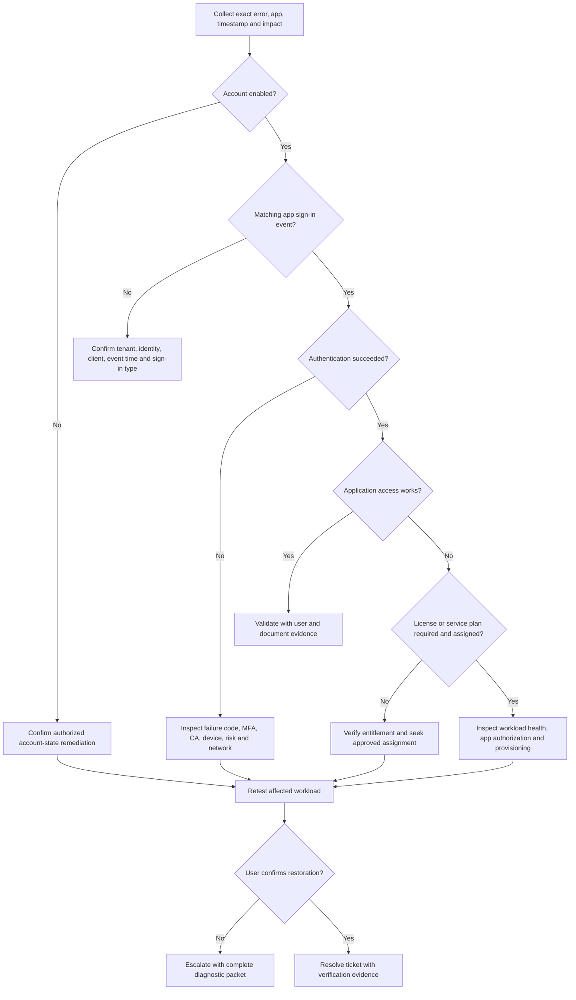

# Identity and Microsoft 365 access diagnostic decision tree

## Key interpretation rules

- An **Azure Portal** success is not proof that **Teams**, **SharePoint**, or **Exchange Online** sign-in succeeds.
- A missing license may explain a workload entitlement failure, but not necessarily an Entra authentication failure.
- A **Global Administrator** directory role does not automatically include Exchange/Teams licensing or Graph delegated OAuth scopes.
- A Graph `/me` success validates that specific delegated REST request, not every SDK cmdlet or Microsoft 365 workload.
- Absence of a failed event in a limited log view does not prove no failures exist.
